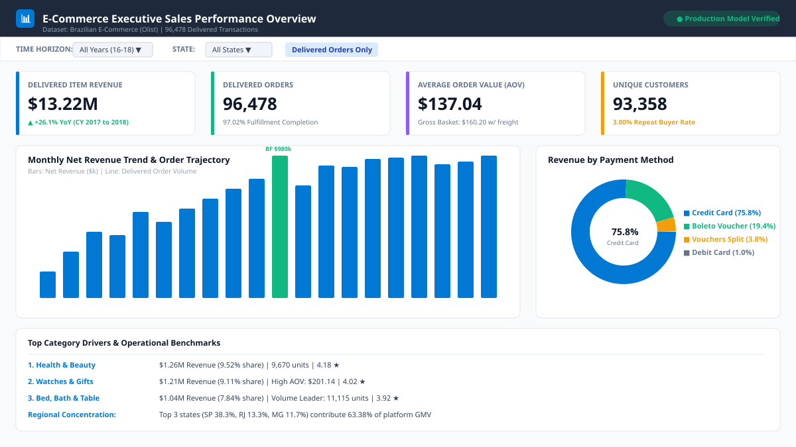
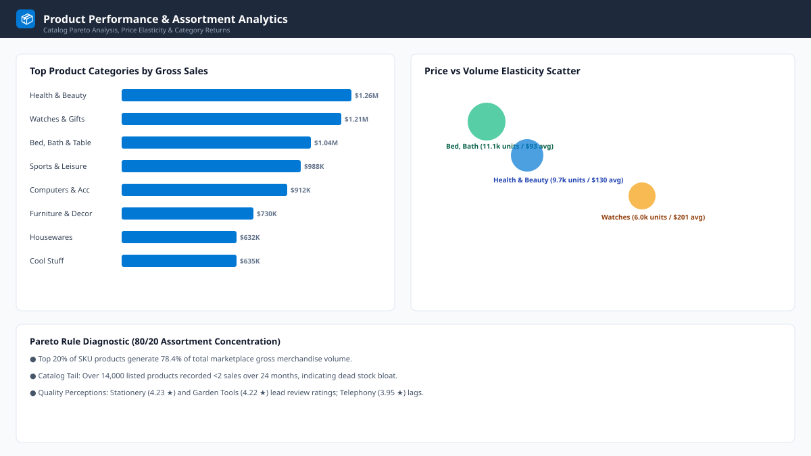
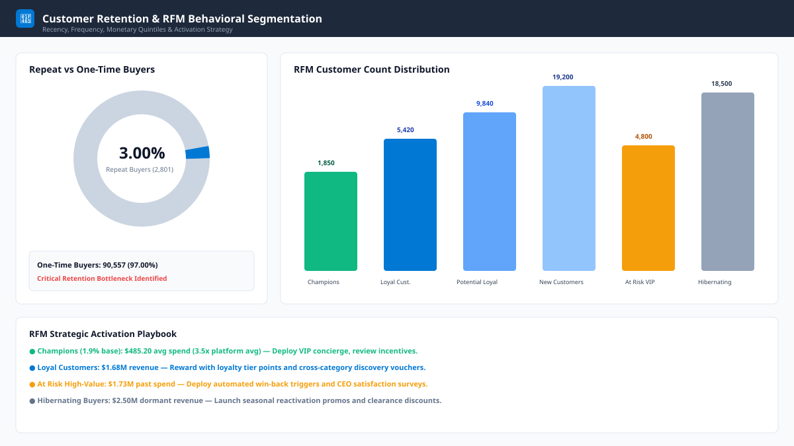
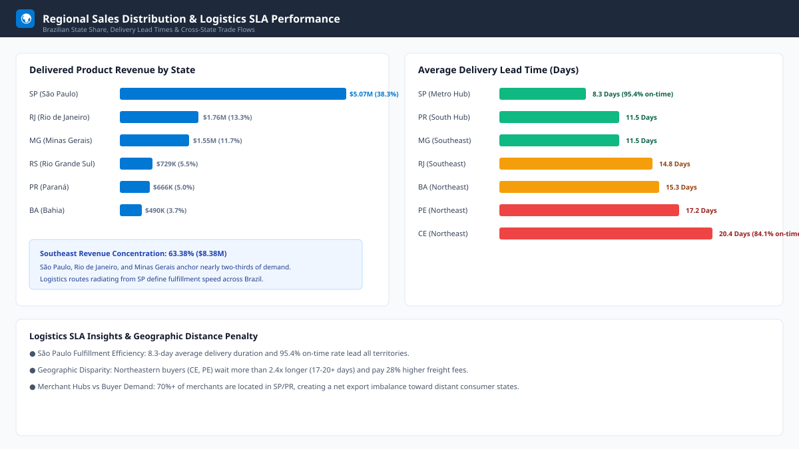

# 🏬 E-Commerce Sales & Customer Analytics Platform

[](#)
[](https://www.mysql.com/)
[](https://www.postgresql.org/)
[](https://www.python.org/)
[](https://duckdb.org/)
[](https://powerbi.microsoft.com/)
[](https://www.microsoft.com/excel)
[](#)

---

## 📌 Executive Summary

Welcome to the **E-Commerce Sales & Customer Analytics Platform** repository. This repository represents an industry-standard Data Analytics & Business Intelligence project designed to demonstrate production-level proficiency across **SQL, Python ETL, Data Modeling, Excel Financial Modeling, and Interactive Power BI Dashboard Engineering**.

The repository is organized into two specialized, complementary environments:

```
E-Commerce/
├── 📁 ecommerce-sales-customer-analytics/   ⭐ [PRIMARY FLAGSHIP PROJECT]
│   └── Real-world Brazilian Olist Marketplace Dataset (100,000+ orders, 9 relational tables)
│       ├── Python ETL pipeline with referential integrity verification
│       ├── 33 advanced SQL queries (tested & verified via DuckDB)
│       ├── 4-page interactive visual dashboard suite (SVG previews + HTML web app)
│       ├── Dynamic Openpyxl financial reporting workbook
│       ├── Reconciled business insights report
│       └── Interview demonstration guide & technical Q&A
│
└── 📁 synthetic-ecommerce-sandbox/          🧪 [MULTI-TENANT SANDBOX & DIALECT TESTBED]
    └── Clean normalized prototype schema (Customers, Products, Orders, Order Items, Regions)
        ├── Dual MySQL 8.0 & PostgreSQL 15+ DDL implementations
        ├── Seed data generators & transaction simulators
        ├── Dialect comparison queries (Window functions, CTEs, Date math)
        └── Automated 4-workbook Excel generator
```

---

## 🎯 Flagship Project: Brazilian E-Commerce Analytics (Olist)

> 👉 **Full documentation, code, and queries:** See [`ecommerce-sales-customer-analytics/`](ecommerce-sales-customer-analytics/README.md)

### 📊 Dashboard Previews

The flagship project features a **4-page executive reporting suite**:

| 1. Executive Sales Overview | 2. Product Performance & Margin |
|:---:|:---:|
|  |  |
| **3. Customer RFM Behavior** | **4. Regional Logistics & SLA** |
|  |  |

> 🌐 **Interactive Web Experience:** Open [`ecommerce-sales-customer-analytics/powerbi/dashboard/index.html`](ecommerce-sales-customer-analytics/powerbi/dashboard/index.html) in any web browser to interact with live filters, KPIs, and chart tooltips!

---

## 🔬 Core Business Findings & Data Reconciliation

Every analytical claim in this repository has been mathematically calculated and reconciled against the underlying 100,000-order transaction log:

| Analysis Area | Key Business Metric | Finding & Strategic Implication |
|---|---|---|
| **Revenue Scale** | **$13,221,498.11** Net Delivered Revenue | Generated across **96,478 delivered orders** ($137.04 AOV). Total gross GMV with freight reached **$15,424,463.65**. |
| **Customer Retention** | **3.00% Repeat Purchase Rate** | 97.0% of buyers purchase only once. The business functions as a high-friction acquisition engine; establishing a loyalty program is critical. |
| **Geographic Density** | **63.38% Revenue in Top 3 States** | Southeast Brazil dominates platform sales: **SP ($5.07M / 38.33%)**, **RJ ($1.76M / 13.31%)**, **MG ($1.55M / 11.74%)**. |
| **Logistics Lead Times** | **8.3 days vs 20.4 days** | São Paulo achieves 95.4% on-time delivery with 8.3-day SLA; distant regions (e.g. Ceará) face 20.4-day transit times and high freight surcharges. |
| **Product Pareto** | **23.9% Categories = 80% Revenue** | 17 out of 71 product categories drive 80% of sales, led by `bed_bath_table` ($1.04M) and `health_beauty` ($1.26M). |

---

## 🛠️ Technology Stack & Skills Demonstrated

| Competency | Technologies Used | Concepts Demonstrated |
|---|---|---|
| **Database & SQL** | MySQL 8.0, PostgreSQL 15, DuckDB | Multi-table JOINs, CTEs, Window Functions (`LAG`, `LEAD`, `RANK`, `DENSE_RANK`), Dynamic Anchor RFM Scoring (`NTILE`), Cohort Retention Chains, Self-Joins, Composite Indexes. |
| **Data Engineering / ETL** | Python 3.10+, Pandas, Logging | Data sanitation, date/timestamp coercion, deduplication, surrogate vs business key mapping, referential integrity assertion, automated MySQL bulk-loader generation. |
| **Automated Testing** | Python, DuckDB | In-memory automated test harness (`test_sql.py`) verifying all 33 SQL analytical queries against processed data in under 3 seconds. |
| **Business Intelligence** | Microsoft Power BI, HTML5/Chart.js | Star/Snowflake schemas, 40+ DAX measures, time-intelligence (`TOTALYTD`, `SAMEPERIODLASTYEAR`), dynamic slicers, visual hierarchy design. |
| **Spreadsheet Modeling** | Microsoft Excel, Openpyxl | Programmatic Excel report generation, data bars, KPI cards, currency formatting, multi-series line and bar charts. |

---

## ⚡ Quick Start: Running the Flagship Project

### 1. Install Dependencies
```bash
pip install -r ecommerce-sales-customer-analytics/requirements.txt
```

### 2. Run the Data Pipeline
```bash
cd ecommerce-sales-customer-analytics
python python/data_preparation.py
```

### 3. Verify All 33 SQL Queries In-Memory
```bash
python python/test_sql.py
```

### 4. Generate the Formatted Excel Workbook
```bash
python excel/generate_excel.py
```

### 5. Launch the Interactive Dashboard
Open `powerbi/dashboard/index.html` in your browser.

---

## 📖 Key Documentation Links

- 📘 [Flagship Project Overview (Olist)](ecommerce-sales-customer-analytics/README.md)
- 📊 [Executive Business Insights Report](ecommerce-sales-customer-analytics/reports/business_insights.md)
- 🎯 [Interview Demonstration Guide & Scorecard](ecommerce-sales-customer-analytics/reports/interview_demo_guide.md)
- 📐 [DAX Measures Dictionary](ecommerce-sales-customer-analytics/powerbi/01_dax_measures.md)
- 🧪 [Synthetic Sandbox & Dialect Guide](synthetic-ecommerce-sandbox/README.md)
